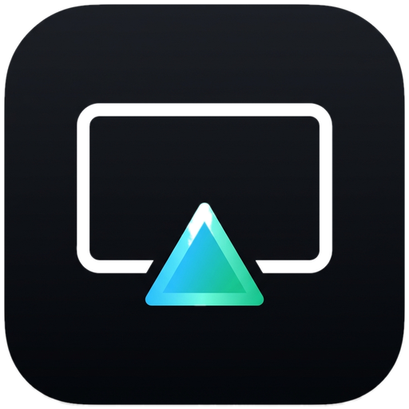

<p align="center">
  
</p>

# NotAirplay

A lightweight, low-latency AirPlay screen mirroring and audio receiver for Windows 10 and 11. Connects directly to your iPhone or iPad over your local Wi-Fi or Ethernet network — no companion iOS apps, Bluetooth pairing, or cloud relays required.

---

## Features

- **Hardware-accelerated video**: Direct3D 11 presentation via a VSync-locked waitable swap chain (`DXGI_SWAP_CHAIN_FLAG_FRAME_LATENCY_WAITABLE_OBJECT`) paired with Windows Media Foundation (DXVA2) decoding and adaptive AirPlay NTP timestamp pacing for smooth Wi-Fi motion with zero added idle-to-touch delay.
- **Selectable frame rate target**: Switch between `30 fps`, `60 fps` (default), or `120 fps` capability advertisements right from the Receiver workspace.
- **In-process WASAPI audio**: Plays **ALAC** lossless (embedded native C decoder) and **AAC-LC** (Windows Media Foundation MFT) completely in-process over Windows WASAPI, alongside low-latency **AAC-ELD** mirroring audio — no external `ffplay.exe` needed.
- **Audio deck & device picker**: Live track/artist metadata readout, hardware volume meter synchronized via WASAPI from iOS volume buttons/Control Center, and instant playback endpoint switching between connected speakers and headphones.
- **Persistent audio standby**: Maintains the AirPlay connection across pauses and track changes just like a dedicated wireless speaker.
- **Custom receiver name**: Set an optional custom AirPlay display name (defaults to `NotAirplay`), saved automatically across launches along with frame rate and audio device preferences.
- **Automatic display wake lock**: Prevents Windows display and system sleep (`SetThreadExecutionState`) while active mirroring is running.
- **Fluent Acoustic Deck UI**: Dark-mode Windows 11 desktop interface (`WPF-UI`) with navigation rail (`Receiver`, `Audio deck`, `Diagnostics` drawer), always-on-top pinning, and distraction-free fullscreen mode.
- **Zero telemetry**: Operates strictly within your local network. No external requests, accounts, or analytics.

---

## Requirements

- **Operating System**: Windows 10 or Windows 11 (64-bit)
- **Runtime**: [.NET 8 Desktop Runtime](https://dotnet.microsoft.com/download/dotnet/8.0)
- **Network**: iPhone/iPad and Windows PC on the same local Wi-Fi or Ethernet subnet
- **FFmpeg** *(optional)*: `ffmpeg.exe` on your system `PATH` for `AAC-ELD` mirroring audio, compatibility mode fallback, and HEVC video decoding (native H.264 video, ALAC audio, and Windows AAC-LC audio run in-process with zero external binaries)

---

## Getting Started

1. Download the latest release from the [Releases](https://github.com/itzenzy2/NotAirplay/releases) page and extract the archive.
2. Launch `NotAirplay.exe`. IPv4 mDNS discovery starts automatically.
3. *(Optional)* Enter a custom **Receiver name** (click **Apply** or press `Enter`), pick a `30` / `60` / `120 fps` target frame rate, or choose an audio output device in **Audio deck**.
4. On your iPhone or iPad:
   - Swipe down to open **Control Center**.
   - Tap **Screen Mirroring** (for video) or tap the AirPlay audio output icon in Now Playing.
   - Select **NotAirplay** (or your custom receiver name).
5. To end the session, tap **Stop Mirroring** on your device or click **Stop mirroring** / **Disconnect** in NotAirplay.

---

## Keyboard Shortcuts & Controls

| Action | Control / Shortcut |
| :--- | :--- |
| **Toggle Full Screen** | `F11` or double-click the video surface |
| **Exit Full Screen** | `Esc` |
| **Keep on Top** | Pin button in the title bar or **Keep window on top** switch |
| **Custom Receiver Name** | **Receiver name** field + **Apply** (`Enter`) |
| **Target Frame Rate** | `30 fps` / `60 fps` / `120 fps` selector on Receiver home |
| **Audio Output Device** | **Output** selector in **Audio deck -> Signal pipeline** |
| **Session Telemetry & Log** | **Details** button in the footer or **Diagnostics** nav item |

Preferences (`CustomName`, `TargetFps`, `AudioDeviceId`) are saved locally in `%LocalAppData%\NotAirplay\settings.json`.

---

## Architecture

NotAirplay implements the AirPlay receiver stack natively on Windows:

- **Pairing & Control**: RTSP control channel (`ControlConnection.cs`) and FairPlay v3 authentication (modes 0–3 via `notairplay-key.exe`), recovering session AES keys locally.
- **mDNS Discovery**: Multi-adapter IPv4 mDNS (`MulticastDiscovery.cs`, with Windows DNS-SD fallback) advertising both `_airplay._tcp.local` and `_raop._tcp.local`, automatically truncating and sanitizing custom names to valid DNS labels.
- **Native Video Pipeline (`native/video.cpp`)**: Decrypts AES-CBC mirror packets, extracts sender NTP timestamps for adaptive Wi-Fi jitter pacing (`paceFrame`), feeds Annex-B frames into the Windows Media Foundation H.264 decoder (DXVA2 hardware accelerated with software MFT and FFmpeg compatibility fallbacks), and presents through a D3D11 VideoProcessor onto a VSync waitable flip-discard swap chain.
- **In-Process WASAPI Audio (`native/audio.cpp`, `MirrorAudio.cs`)**: Receives encrypted RTP audio over UDP, decodes ALAC in-process (`native/alac.c`) and AAC-LC via `CLSID_CMSAACDecMFT` (with headless `ffmpeg.exe` PCM piping for `AAC-ELD`), and renders through shared-mode WASAPI with auto sample-rate conversion (`AUDCLNT_STREAMFLAGS_AUTOCONVERTPCM`), jitter pre-roll, burst trim, fade-out underrun concealment, instant `ISimpleAudioVolume` sync, RTSP `FLUSH` clearing, and live device switching.

---

## Building from Source

### Prerequisites

- [.NET 8 SDK](https://dotnet.microsoft.com/download/dotnet/8.0)
- [LLVM-MinGW](https://github.com/mstorsjo/llvm-mingw/releases) (or Clang/GCC C++17 toolchain on Windows)

### Build & Test

```powershell
git clone https://github.com/itzenzy2/NotAirplay.git
cd NotAirplay

# Build native components (notairplay-key.exe, notairplay-video.dll),
# compile the WPF app, and run the full test suite:
powershell -ExecutionPolicy Bypass -File .\Build.ps1 -Clang C:\path\to\llvm-mingw\bin\clang.exe -Test
```

Compiled binaries are written to `bin/Release/net8.0-windows/`.

---

## Troubleshooting

- **Device cannot find NotAirplay**: Confirm both devices are on the same subnet without router AP/Client Isolation enabled, and allow `NotAirplay.exe` TCP/UDP through Windows Firewall.
- **No audio on AAC-ELD / HEVC video**: Ensure `ffmpeg.exe` is installed and accessible on your `PATH`.
- **Playback artifacts or black screen**: Open **Details** and enable **Compatibility mode** (next connection uses FFmpeg compatibility decode).
- **Diagnostics**: Click **Copy diagnostics** inside the telemetry drawer to copy the activity log, mDNS adapter summary, and active session counters.

---

## License & Acknowledgments

NotAirplay is open-source software released under the [MIT License](LICENSE). Third-party components and cryptographic notices are documented in [THIRD-PARTY-NOTICES.md](THIRD-PARTY-NOTICES.md).
